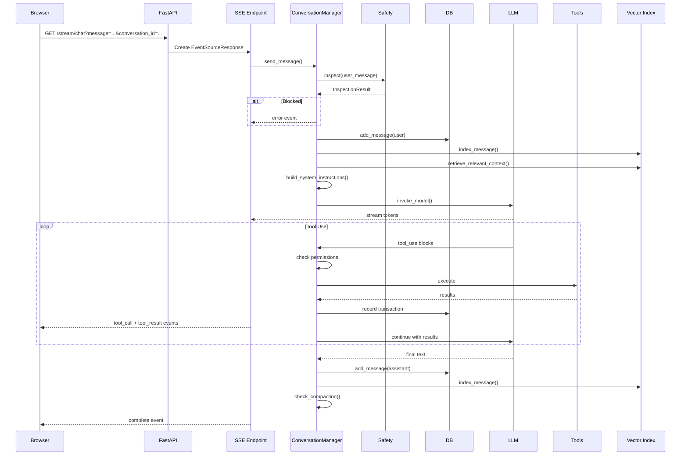
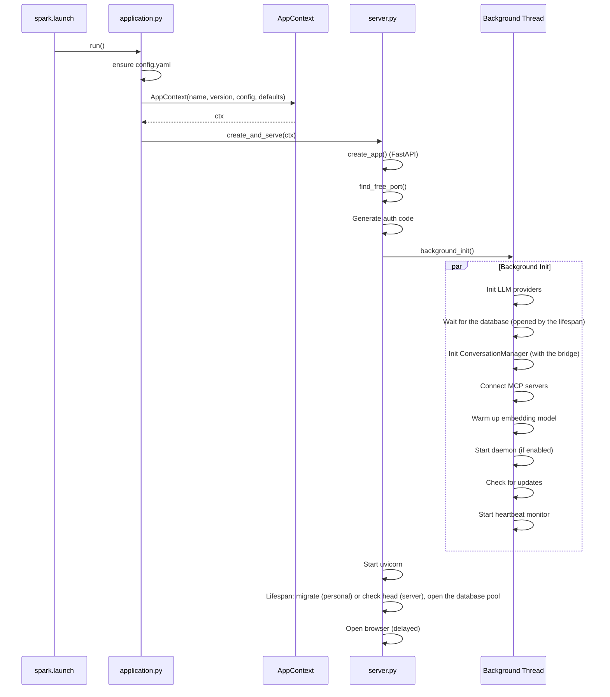
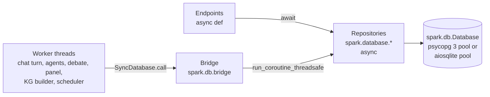

# Architecture

This document describes the system architecture, component overview, data flow, and database schema for Spark.

## High-Level Architecture

```mermaid
graph TB
    subgraph Browser
        UI[Web UI<br/>Bootstrap 5.3 + Cognisn Theme]
        SSE[SSE Client]
    end

    subgraph "Spark Server (FastAPI + Uvicorn)"
        Web[Web Layer<br/>FastAPI Endpoints]
        Auth[Auth Manager<br/>One-time Codes]
        Session[Session Manager]

        subgraph Core
            CM[Conversation Manager]
            CC[Context Compactor]
            UG[User GUID]
            UP[Updater]
        end

        subgraph LLM
            LM[LLM Manager]
            Anthropic[Anthropic Direct]
            Bedrock[AWS Bedrock]
            Ollama[Ollama]
            Gemini[Google Gemini]
            XAI[X.AI / Grok]
        end

        subgraph Tools
            TR[Tool Registry]
            FS[Filesystem]
            Doc[Documents]
            Arc[Archives]
            WebT[Web Search/Fetch]
            Mem[Memory Tools]
            DT[DateTime]
        end

        subgraph MCP
            MM[MCP Manager]
            MC1[MCP Client 1]
            MC2[MCP Client N]
        end

        subgraph Safety
            PI[Prompt Inspector]
            PM[Pattern Matcher]
        end

        subgraph Index
            VI[Vector Index]
            MI[Memory Index]
            EM[Embedding Model]
        end

        subgraph Scheduler
            AR[Action Runner]
            AE[Action Executor]
        end
    end

    subgraph "System Tray"
        TD[Tray Daemon]
    end

    subgraph Storage
        DB[(Database<br/>SQLite (personal) / PostgreSQL (server))]
        KC[OS Keychain<br/>Secrets]
    end

    UI <-->|HTTP + SSE| Web
    SSE <-->|Server-Sent Events| Web
    Web --> Auth
    Web --> Session
    Web --> CM
    CM --> LM
    CM --> TR
    CM --> MM
    CM --> CC
    CM --> PI
    CM --> VI
    LM --> Anthropic
    LM --> Bedrock
    LM --> Ollama
    LM --> Gemini
    LM --> XAI
    TR --> FS
    TR --> Doc
    TR --> Arc
    TR --> WebT
    TR --> Mem
    TR --> DT
    Mem --> MI
    MI --> EM
    VI --> EM
    CM --> DB
    TD --> AR
    AR --> AE
    AE --> LM
    AE --> TR
    UG --> KC
```

## Component Overview

### Web Layer

- **FastAPI** application with Jinja2 templates
- **Uvicorn** ASGI server (random port per startup)
- **SSE streaming** for real-time chat responses via `sse-starlette`
- **Auth middleware** protecting all routes except login/static, through `app.state.authenticator` (a `WebAuthenticator`: personal mode's single-use, expiring, rate-limited sign-in codes and one session; server mode swaps in warden)
- **Request guard** (`spark.web.security`) refusing state-changing requests and event streams that do not come from the instance's own origin, and state-changing requests without the session's CSRF token; pages send the token through `static/js/csrf.js`
- **Static files** served from `web/static/` (CSS, JS, fonts)

### Core

- **ConversationManager** -- Central orchestrator connecting database, LLM, tools, MCP, memory, and compaction; synchronous, runs on a worker thread per turn and reaches the database through the bridge (see Data Layer)
- **ContextCompactor** -- LLM-driven intelligent context summarisation with categorised preservation
- **UserGUID** -- Persistent user identifier stored in the OS keychain
- **Updater** -- GitHub release checker with PyApp/pip update support

### LLM Layer

- **LLMManager** -- Routes requests across multiple registered providers
- **LLMService** -- Abstract base class that all providers implement
- **ContextLimitResolver** -- Resolves context window and max output for any model ID

Each provider normalises responses to a common format:

```python
{
    "content": str,          # Text response
    "stop_reason": str,      # end_turn, tool_use, max_tokens
    "usage": {
        "input_tokens": int,
        "output_tokens": int,
    },
    "tool_use": list | None, # Tool call blocks
    "content_blocks": list,  # Raw content blocks
}
```

### Tool System

- **ToolRegistry** -- Assembles enabled built-in tools and dispatches execution
- **ToolSelector** -- Intelligently selects relevant tools based on message content
- Each tool module exports `get_tools()` (definitions) and `execute()` (handler)

### MCP Integration

- **MCPManager** -- Manages multiple MCP server connections with tool caching
- **MCPClient** -- Client for a single server supporting stdio, HTTP, and SSE transports
- Tools from MCP servers are merged with built-in tools transparently

### Safety

- **PromptInspector** -- Multi-level prompt inspection with configurable actions
- **PatternMatcher** -- Compiled regex patterns for injection, jailbreak, code injection, and PII detection

### Index

- **ConversationVectorIndex** -- Per-conversation vector index for RAG retrieval
- **MemoryIndex** -- Cross-conversation persistent memory with semantic search
- **EmbeddingModel** -- Lazy-loaded sentence-transformers model (thread-safe singleton)

### Scheduler

- **ActionRunner** -- APScheduler-based background scheduler for autonomous actions
- **ActionExecutor** -- Runs a single action with its own LLM instance and tool access
- **CreationTools** -- AI-assisted action creation with validation and scheduling

### Daemon

- **SparkTrayDaemon** -- System tray application with pystray
- **DaemonManager** -- Process lifecycle management (start, stop, status)

## Request Flow

### Chat Message



## Startup Sequence



`application.run()` validates the mode first (`spark.mode.configure`): server mode
refuses to start without a PostgreSQL `database.url`.

## Modes

One codebase, two modes, chosen by the `mode` setting (`SPARK__MODE`), read once at
start-up. Code asks `spark.mode.current_mode()` or `spark.mode.is_server()`, never
the raw settings.

| | Personal | Server |
|---|---|---|
| Database | SQLite in the platform data directory | PostgreSQL from `database.url` (`SPARK__DATABASE__URL`) |
| Schema changes | applied automatically at start-up | `spark migrate` first; start-up refuses a database behind head |
| Users | one local user | multi-user (identity through warden from a later release) |

## Data Layer



- `spark.db.Database` owns the connections (a psycopg 3 `AsyncConnectionPool` in server
  mode, a WAL-mode aiosqlite pool in personal mode) and is bound to the event loop that
  opened it: uvicorn's loop in the web process, its own loop thread in the tray daemon
  (`spark.db.standalone`).
- Repositories in `spark.database` are async functions taking an `Executor` (a
  `Database` or a `Connection`) first. SQL is written once with `?` placeholders in the
  subset both engines accept; `spark.db.dialect` adapts it.
- `Database.transaction(conn)` joins a caller's transaction through a savepoint, so a
  second writer (warden's audit recorder, in server mode) commits or rolls back with
  the caller.
- Synchronous code on worker threads uses `SyncDatabase.call(repo.fn, *args)`, the one
  documented bridge. It refuses to run on the database loop's own thread (that would
  deadlock) and times out instead of hanging. A unit of work needing several statements
  is one repository coroutine, never a connection held across bridged calls.
- PostgreSQL sessions run in UTC in the `spark` schema; timestamps are returned as
  ISO 8601 text in both engines.

## Migrations

An Alembic chain in `src/spark/migrations/`, run by `spark.db.migrate`:

- PostgreSQL: SPARK's tables and `spark.alembic_version` live in the `spark` schema;
  SQLite uses the default schema.
- Revision `0001` (baseline) is the SPARK 0.2.0 schema exactly, built from its frozen
  statements (`spark/migrations/schema_0_2_0.py`).
- A SQLite database from 0.2.x or earlier (tables, no version table) gets a one-time
  legacy upgrade: 0.2.0's statements and ALTERs, a check of every column and index
  against the baseline (refusing and changing nothing on any difference), then a stamp.
- `spark migrate` runs SPARK's chain, then every chain registered with
  `spark.db.migrate.register_chain` (warden's, in its own `warden` schema, from the
  identity release).

## Database Schema

### Entity Relationships

```mermaid
erDiagram
    conversations ||--o{ messages : contains
    conversations ||--o{ conversation_files : has
    conversations ||--o{ conversation_links : source
    conversations ||--o{ conversation_links : target
    conversations ||--o{ mcp_transactions : records
    conversations ||--o{ conversation_model_usage : tracks
    conversations ||--o{ conversation_mcp_servers : configures
    conversations ||--o{ conversation_embedded_tools : configures
    conversations ||--o{ conversation_tool_permissions : stores
    conversations ||--o{ context_index_elements : indexes
    conversations ||--o{ rollup_history : compacts

    autonomous_actions ||--o{ action_runs : executes
    autonomous_actions ||--o{ action_tool_permissions : permits
```



### Table Summary

| Table | Purpose |
|-------|---------|
| `conversations` | Conversation metadata, settings, token counts |
| `messages` | Message history (role, content, tokens, rollup status) |
| `rollup_history` | Context compaction records |
| `conversation_files` | Attached files (content + metadata) |
| `conversation_links` | Links between conversations for shared context |
| `mcp_transactions` | Tool execution audit log |
| `conversation_model_usage` | Per-model token usage tracking |
| `conversation_mcp_servers` | Per-conversation MCP server enable/disable |
| `conversation_embedded_tools` | Per-conversation tool enable/disable |
| `conversation_tool_permissions` | Tool approval status per conversation |
| `usage_tracking` | Global token usage and cost tracking |
| `prompt_inspection_violations` | Security violation records |
| `context_index_elements` | Vector index for RAG retrieval |
| `user_memories` | Persistent memories with embeddings |
| `autonomous_actions` | Scheduled action definitions |
| `action_runs` | Action execution history |
| `action_tool_permissions` | Tool permissions for actions |
| `daemon_registry` | Daemon process tracking |

### Key Columns: conversations

| Column | Description |
|--------|-------------|
| model_id | Active LLM model |
| instructions | Custom system prompt |
| total_tokens | Running token count |
| rag_enabled / rag_top_k / rag_threshold | RAG settings |
| max_history_messages | Message history limit |
| is_favourite | Star status |
| web_search_enabled | Web search toggle |
| memory_enabled | Memory tools toggle |

### Key Columns: autonomous_actions

| Column | Description |
|--------|-------------|
| action_prompt | The AI instruction |
| model_id | Which model to use |
| schedule_type | one_off or recurring |
| schedule_config | JSON (cron or run_at) |
| context_mode | fresh or cumulative |
| failure_count / max_failures | Auto-disable tracking |
| locked_by / locked_at | Execution lock |
