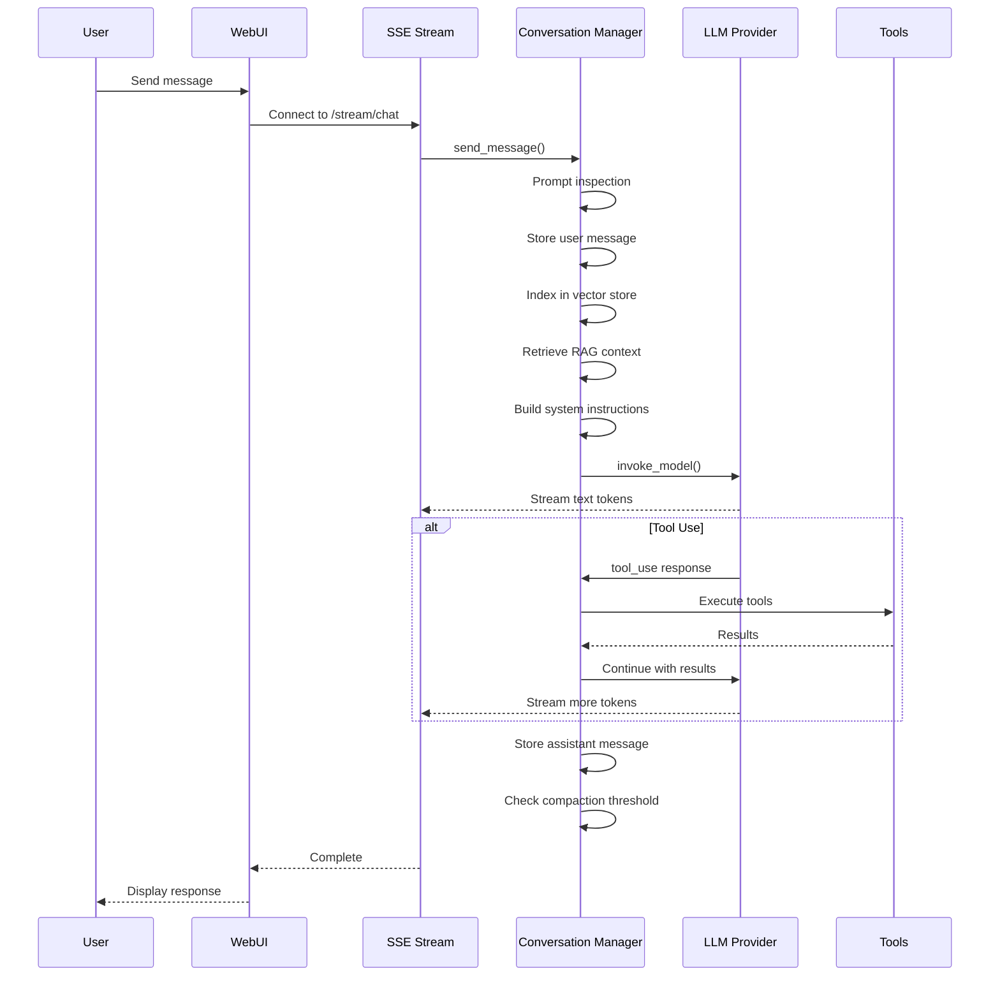

# Conversations

Conversations are the core interaction unit in Spark. Each conversation maintains its own message history, model selection, tool permissions, and settings.

## Creating a Conversation

1. Navigate to **Conversations** from the main menu
2. Click **New Conversation**
3. Enter a name and select a model; models are grouped by connection, with each model's tier (and, on a metered server connection, the credits you have left)
4. Optionally add custom instructions (system prompt for this conversation)
5. Click **Create**

If a default model is configured in Settings, it will be pre-selected.

## Chat Interface

The chat page provides:

- **Message input** with Enter to send and Shift+Enter for new lines
- **Streaming responses** with real-time text rendering
- **The conversation panel** on the right, with Artefacts, Tools and Agents sections (see [The Conversation Panel](#the-conversation-panel))
- **Token counter** displaying input/output tokens for the current exchange
- **Voice input** via the microphone button (browser speech recognition)
- **Voice mode** for hands-free conversation (see [Voice](voice.md))

## Message Handling

### Tool Use Loop

When the model requests tool use, Spark enters a tool execution loop:

1. The model returns one or more tool calls
2. Spark checks tool permissions (prompting the user if needed)
3. Each tool is executed and results are collected
4. Tool results are sent back to the model
5. The model either requests more tools or returns a text response

The loop is bounded by `max_tool_iterations` (default: 25) to prevent runaway tool use.

## Context Compaction

As conversations grow, they can approach the model's context window limit. Spark uses LLM-driven summarisation to compact the context intelligently.

### How It Works

Spark keeps its own summary prompt, markers and rollup history, and lets conduit's compaction layer decide when and where to cut.

1. **Threshold check:** After each exchange, Spark checks if total tokens exceed `rollup_threshold` (default: 30% of context window)
2. **LLM summarisation:** The conversation before the latest assistant turn is sent to the model with a structured summarisation prompt. The latest assistant turn (with its tool calls and results) always stays as it was, after the summary, and the model reads the summary first
3. **Categorised output:** The summary preserves critical decisions, unresolved issues, and implementation details while compressing resolved topics
4. **Message replacement:** Original messages are marked as "rolled up" and replaced with the compact summary. While the conversation still fits the model's window, a compaction is applied only if it brings the conversation under the threshold, so no summary is paid for that could not help
5. **Emergency fallback:** If tokens reach `emergency_rollup_threshold` (95%) and no usable summary is made, the older turns give way to a truncation notice and the latest assistant turn stays

A conversation with no assistant turn yet is never compacted. The system prompt and any skills loaded in the conversation are never touched, so the cached prompt prefix is the same before and after a compaction. On a server, changes to the three thresholds and to prompt caching in the instance settings apply at the next check, without a restart.

### Compaction Categories

The summarisation prompt instructs the model to categorise information:

- **PRESERVE (full fidelity):** Architectural decisions, unresolved issues, code paths, user preferences, active tasks, error context
- **COMPRESS (reduced fidelity):** Resolved tasks, exploratory discussion, tool outputs, explanations
- **DISCARD:** Redundant information, pleasantries, superseded decisions

### Per-Conversation Settings

In the conversation settings (gear icon), you can configure:

- **Compaction threshold** -- Override the global threshold
- **Compaction model** -- Use a different model for summarisation
- **Summary ratio** -- Target size relative to original (default: 30%)

## Conversation Linking

Conversations can be linked together to share context. When conversation A is linked to conversation B, relevant context from B is automatically included when querying A.

### Setting Up Links

1. Open a conversation
2. Click the gear icon for settings
3. Go to the **Context** tab
4. Under **Linked Conversations**, select conversations to link

Linked conversations are searched via the vector index during RAG retrieval, so context from linked conversations appears when semantically relevant.

## RAG (Retrieval-Augmented Generation)

Each conversation maintains a vector index of all messages, tool calls, and tool results. When you send a new message, Spark:

1. Encodes the message using the embedding model (all-MiniLM-L6-v2)
2. Searches the current conversation's vector index (and linked conversations)
3. Retrieves the top-k most relevant context items above the similarity threshold
4. Injects the retrieved context into the system prompt

### Per-Conversation RAG Settings

- **rag_enabled** -- Enable/disable RAG for this conversation (default: true)
- **rag_top_k** -- Number of context items to retrieve (default: 5)
- **rag_threshold** -- Minimum similarity score (default: 0.4)

## Favourites

Star a conversation to mark it as a favourite. Favourites appear at the top of the conversation list and on the dashboard. In a shared conversation your star is your own.

## Sharing a Conversation (server mode)

On a server you can share a conversation with other people on the same instance. Personal mode has one person, so it has no sharing.

### Roles

| Role | Can |
|------|-----|
| **Owner** | Everything: send, share, change roles, remove people, transfer, rename, change the model and settings, link conversations, delete |
| **Contributor** | Read the whole conversation, send messages as themselves, add attachments, export |
| **Read-only** | Read the whole conversation (messages, attachments, tool calls and results, the thought process where shown) and export it |

Whoever creates a conversation is its owner.

### Sharing

1. Open the conversation and click **Share** (only the owner sees it)
2. Type at least two letters of a person's name or email address; anyone with an active account on the instance can be found
3. Choose **Read-only** or **Contributor** and click **Add**

The dialog warns that everything already in the conversation becomes visible to the people you share it with. The person sees it at once under **Shared with me** on the Conversations page, marked **New** until they open it, with a count of the new ones. When the instance has a mail server, they are also sent a short notice with the conversation's name and link (never anything said in it).

In the dialog the owner can change a person's role, **Remove** them, or **Make owner**. A removal takes effect at once: the person's open view closes, and if their turn is running it is cancelled. Anyone other than the owner can leave a conversation from the Shared with me list.

### Transferring ownership

**Make owner** hands the conversation to someone who already has access, or to a person found in the dialog, who is added in the transfer. The new owner takes over sharing, settings and deletion and is told by mail; the previous owner stays as a contributor. Links between the conversation and the previous owner's other conversations are removed, and their knowledge graph builds and actions stay with them.

### Taking turns

Each message is sent as the person who wrote it, and the turn that answers it is theirs: it uses their credits, their tools and tool approvals (an "allow in this conversation" answer is your own, never another person's), and it is recorded in their usage. If the conversation's model is not one you may use, the composer says so and you cannot send.

One turn runs at a time. While the assistant answers one person, everyone viewing the conversation sees the reply stream in, and the others' composers say **Waiting for <name>'s turn to finish**. New messages and replies appear for everyone without a reload.

Each person's messages carry their name, initials and their own colour, and the assistant's replies say whose turn they answered. The colours are chosen to be told apart with any colour vision and are always shown with the name. The conversation's header shows a sharing icon with the people in it, and the Conversations page marks your own shared conversations with the same icon.

### What stays private

While a conversation is shared with anyone, every turn in it (the owner's too) runs without personal memories and without knowledge graphs: no memory or knowledge graph tools, no knowledge graph context, and no context from linked conversations. Your own memories and graphs are never put into an answer others can read.

These stay with the owner and are never reachable by the people they share with: linked conversations, actions created from the conversation, knowledge graph builds, and the owner's file area. Files attached in the conversation are the exception: everyone with access can open them.

Debates and panels cannot be shared.

Every share, role change, removal, transfer and refused message is recorded in the audit trail, with the address it came from.

## Document Preview

The assistant can show you a document in a pane on the right of the conversation, with the `show_document` tool: a document link returned by one of your MCP servers (for example a document link from a knowledge base), or a file in the conversation. Ask it to "show me" a document, or it may offer to.

- **The pane** opens beside the conversation with one tab per document. Drag its left edge (or focus the edge and use the left and right arrow keys) to make it wider or narrower; your width is remembered. Each tab has **Download** and **Close**, and the pane's own close button closes every tab. In the tab strip, the arrow keys move between tabs and **Delete** closes one. At phone width the pane covers the screen; **Escape** or Close returns to the conversation.
- **The card.** Each document shown leaves a card in the conversation with its name, type and size. Click the card to open the document again.
- **What is shown.** PDF; Word documents (.docx); Excel workbooks (.xlsx and .xls) and CSV files, as read-only tables with a tab per sheet (the first 1,000 rows); images (PNG, JPEG, GIF, WebP, BMP and SVG, shown as pictures only); Markdown; and text and code with line numbers (HTML is shown as its text, never as a page). Anything else shows its name, type and size, with **Download**.
- **Kept with the conversation.** A document fetched from a link is stored in your file area as a file of the conversation, so it stays available after the link expires. It counts towards your storage quota and must be within the attachment size limit. A file of yours from elsewhere is copied into the conversation when it is shown.
- **Shared conversations.** Everyone with access to the conversation can open its documents, and when the assistant shows one in someone's turn it opens in every viewer's pane. A person removed from the conversation can no longer open them.

Documents are drawn inside a sealed frame: nothing in a document can run in Spark's page, reach your session, or load anything from the internet. Spark serves every library the preview uses itself, so no page asks a third party for them.

Spark fetches a link only from the address of an MCP server you are connected to, and never follows it to another site. The assistant tells you plainly when it cannot show something, for example a link to another site, a document larger than the attachment limit, or a file that is not what it says it is.

## The Conversation Panel

One panel on the right of the conversation holds three sections, each a button with a count: **Artefacts**, **Tools** and **Agents**. Open it with the **Panel** button in the toolbar; at phone width it fills the screen, and Escape or its close button returns to the conversation.

- **Artefacts** is open when a conversation opens; Tools and Agents are closed. A section opens by itself while something runs in it (a tool call, an agent) and then stays as you leave it. The sections you open and close are remembered in your browser, one choice per section; if your browser blocks storage the panel still works and starts from the defaults each time.
- **The first time** an artefact appears in a conversation the panel opens by itself. After that, new items light a dot on the Panel button while the panel is closed, and opening it clears the dot.
- **Tools** lists the tool calls of the conversation by day, with their parameters and results, and **Agents** the agent runs, as they always have.
- **Artefacts** has up to three groups. **Generated or retrieved** holds documents the assistant created, documents it fetched to show you, and charts and diagrams. **Provided** (**Provided by you** in a conversation you have not shared) holds the files attached in the conversation; in a shared conversation each file says who attached it. **Project resources** appears only in a conversation inside a project and lists the resources it inherits, one group for each level of the project.
- **Each item** shows its title, with its file name, type and size beneath, and when it appeared. Click it to open it in the document preview pane (charts and diagrams too); the conversation scrolls to the message that produced it and marks the message briefly. While the preview pane is open the panel narrows (at phone width it steps aside), and it returns when you close the pane.
- **Renaming.** The conversation's owner and its Contributors can rename a generated or provided artefact with the pencil button: type a new title of up to 120 characters and press Enter or Save. Read-only members and project resources have no pencil. Each rename is recorded in the audit trail (server mode), and everyone viewing the conversation sees the new title.
- **Shared conversations.** Everyone with access sees the same list, and new items appear without reloading. A person removed from the conversation can no longer list or open its artefacts.

Drag the panel's left edge (or focus it and use the left and right arrow keys) to change its width.

## Conversation Export

Export a conversation from the chat settings menu. In a shared conversation everyone with access can export it. Available formats:

| Format | Description |
|--------|-------------|
| **Markdown** | Full conversation with formatting preserved |
| **HTML** | Rendered HTML with styling |
| **CSV** | Tabular format (timestamp, role, content) |
| **JSON** | Raw message data for programmatic use |

## Conversation Settings Summary

| Setting | Description | Default |
|---------|-------------|---------|
| Instructions | Custom system prompt | None |
| Model | LLM model to use | Per-provider default |
| RAG enabled | Vector search context retrieval | true |
| RAG top_k | Number of context items | 5 |
| RAG threshold | Minimum similarity | 0.4 |
| Max history messages | Limit messages sent to model | All |
| Include tool results | Send tool results in history | true |
| Web search enabled | Enable web search tool | false |
| Memory enabled | Enable memory tools | true |
