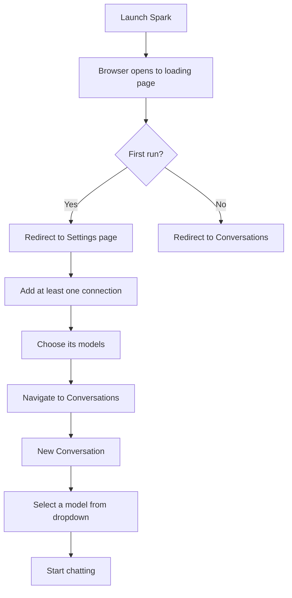
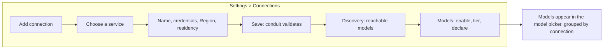

# Getting Started with Spark

This guide covers every supported installation method, first-run configuration, and upgrading.

---

## Prerequisites

- **Python 3.12 or later** is required for pip-based installation.
- A modern web browser (Chrome, Firefox, Safari, Edge) for the web UI.
- A credential for at least one model service (an Anthropic, OpenAI, X.AI or Google Gemini API key, AWS or Microsoft Foundry credentials), or a running Ollama instance.

---

## 1. Install via pip

The simplest path if you already have a Python environment.

```bash
pip install cognisn-spark
```

Then launch:

```bash
spark
```

Spark starts a local web server and opens your browser automatically.

### Run with uv

[uv](https://docs.astral.sh/uv/) can install and run Spark from PyPI without a
manually managed environment:

```bash
uv tool install cognisn-spark    # then run:
spark
```

`uv tool install` keeps Spark and its (large) dependencies installed between
runs. For a throwaway run, `uvx cognisn-spark` works too but re-downloads
everything each time.

### CPU-only PyTorch on Linux

Spark computes embeddings on the CPU. On Linux the default PyTorch from PyPI also
installs about 2.4 GB of NVIDIA CUDA packages that Spark never uses. Install the
CPU-only build instead (macOS and Windows already get it):

```bash
# uv
uv tool install cognisn-spark --torch-backend cpu

# pip: PyTorch from its CPU index first, then Spark
pip install torch --index-url https://download.pytorch.org/whl/cpu
pip install cognisn-spark
```

With pip, upgrade Spark with `pip install --upgrade cognisn-spark`; upgrading torch
itself without `--index-url` would bring the CUDA build back.

On a headless server, disable the browser auto-open and pin a port:

```bash
SPARK__INTERFACE__OPEN_BROWSER=false SPARK__INTERFACE__PORT=8765 spark
```

### Databases

By default Spark runs in personal mode and uses SQLite, which requires no additional
packages. Server mode uses PostgreSQL through psycopg 3, which is installed with Spark:

```bash
export SPARK__MODE=server
export SPARK__DATABASE__URL=postgresql://spark@db.example.com:5432/spark
spark migrate
spark
```

Personal mode applies schema changes automatically at start-up; in server mode run
`spark migrate` after each upgrade (Spark refuses to start on an older schema). MySQL
and SQL Server are no longer supported.

Server mode stores memory and conversation vectors with the
[pgvector](https://github.com/pgvector/pgvector) extension, version 0.8 or later (the
`pgvector/pgvector` PostgreSQL images include it). `spark migrate` creates the `vector`
extension if it is missing, which needs a database role allowed to create it;
otherwise have an administrator run `CREATE EXTENSION vector;` in the database first.

### Verifying installation

```bash
spark --version
```

Or if running from the source package:

```bash
python -m spark.launch
```

---

## 2. macOS DMG

Available for both **ARM64** (Apple Silicon -- M1/M2/M3/M4) and **x86_64** (Intel) architectures. The DMG is code-signed with a Developer ID certificate and notarized by Apple.

### Step by step

1. **Download** the `.dmg` file for your architecture from the [Releases](https://github.com/Cognisn/spark/releases) page.

2. **Open** the DMG by double-clicking. Drag the **Spark** icon into the **Applications** folder.

3. **Launch Spark**. Double-click Spark in Applications. The app is notarized by Apple, so it should open without any Gatekeeper warnings.

   > **Troubleshooting**: If macOS shows a warning that "Spark can't be opened", this means the notarization ticket was not stapled to this build. In that case:
   > - Right-click (or Control-click) on Spark in Applications and choose **Open**. Click **Open** again to confirm.
   > - Or go to **System Settings > Privacy & Security**, scroll down, and click **Open Anyway**.
   > - Or run `xattr -cr /Applications/Spark.app` in Terminal to remove the quarantine attribute.

4. On first launch, a splash screen appears while the Python runtime is extracted and dependencies are downloaded from PyPI. This takes 30-60 seconds and requires an internet connection. Subsequent launches start in a few seconds.

5. Your browser opens to the Spark loading screen, then redirects to the UI when ready.

---

## 3. Windows NSIS Installer

### Step by step

1. **Download** the `Spark-<version>-windows-x86_64-setup.exe` from the [Releases](https://github.com/Cognisn/spark/releases) page.

2. **Run the installer**. Follow the setup wizard. The default install location is:

   ```
   C:\Program Files\Cognisn\Spark
   ```

3. The installer creates:
   - A **desktop shortcut**
   - A **Start Menu** entry under Cognisn > Spark

4. **Launch** from the desktop shortcut or Start Menu.

5. On first launch, a splash screen appears while the Python runtime is extracted and dependencies are downloaded from PyPI. This takes 30-60 seconds and requires an internet connection. Subsequent launches start in a few seconds.

6. Your browser opens to the Spark UI.

7. **Windows Firewall**: on first launch Windows may ask whether to allow Spark to communicate on the network. Choose **Allow access** -- Spark needs this to serve its local web UI and to reach LLM provider APIs.

---

## 4. Linux

Linux users install via pip (see section 1 above). Pre-built binaries are not currently available for Linux. Any desktop Linux distribution with Python 3.12+ and a web browser is supported.

---

## 5. First-Run Configuration

After launching Spark for the first time, the following flow applies regardless of installation method.

### First-run flow



### Required: add at least one connection

Spark reaches models through **connections**. Before you can start a conversation, add
at least one in **Settings > Connections** (the first section of Settings):

1. Choose **Add connection** and pick a service: Amazon Bedrock, Claude through Amazon
   Bedrock (mantle), Anthropic, Claude in Microsoft Foundry, OpenAI, X.AI, Microsoft
   Foundry (OpenAI-compatible), Google Gemini or Ollama.
2. Give it a name and fill in the service's fields: an API key for Anthropic, OpenAI,
   X.AI or Google Gemini; the Region and an authentication mode for Amazon Bedrock; the
   Base URL (`http://127.0.0.1:11434` by default) for Ollama. The key goes to your OS
   keychain and is never shown again.
3. Save. Spark checks the settings and then which models the connection can reach.
4. Open the connection's **Models** to see what it offers. Every model its residency
   policy allows is offered until you turn some off. Models you pulled into Ollama
   that Spark's catalogue does not know are listed apart, to declare.

[Model services](providers.md) explains getting a key from each service, and
[Connections](connections.md) covers every field. You can add several connections,
even of one service.

### Start chatting

1. Navigate to **Conversations** using the sidebar.
2. Click **New Conversation**.
3. Select a model from the dropdown. Models are grouped by connection.
4. Type a message and press Enter.

### Optional recommended settings

- **Default Model** -- in Settings under **Default Model**, pick the model you use most often. New conversations will pre-select it.
- **Filesystem access** -- if you want the AI to read or write files on your system, go to Settings and add paths under **Filesystem > Allowed Paths**. Only the listed directories (and their children) will be accessible to file tools.

### Connection flow



---

## 7. Upgrading

### pip

```bash
pip install --upgrade cognisn-spark
```

Then restart Spark. Your conversations and settings are preserved.

Upgrading from 0.2 to 0.3.0 converts `config.yaml`'s `providers` section into named
connections on the first start, keeping each key in the keychain; see
[Upgrading from 0.2](connections.md#upgrading-from-02).

### macOS DMG

1. Download the new DMG from the Releases page.
2. Open the DMG and drag Spark to Applications, replacing the existing copy.
3. Launch Spark. The launcher auto-detects the upgrade and runs any necessary migrations.

### Windows installer

1. Download and run the new setup executable.
2. The installer clears the PyApp cache automatically and replaces the previous installation.
3. Launch Spark from the desktop shortcut or Start Menu as usual.

### Linux (pip)

```bash
pip install --upgrade cognisn-spark
```

### Auto-update notifications

Spark checks for new versions in the background. When an update is available:

1. A notification badge appears on the **Help** menu in the web UI.
2. A modal displays on the dashboard showing the current and latest version with rendered release notes.
3. Click **Download Update** to open the GitHub releases page where you can download the new installer for your platform.

---

## Navigation

The web interface has the following sections:

| Page | Description |
|------|-------------|
| **Home** | Dashboard with recent conversations, your model connections, and tool overview |
| **Conversations** | List, search, create, and manage conversations |
| **Memories** | View and manage persistent memories |
| **Actions** | Configure autonomous scheduled AI tasks (if enabled) |
| **Settings** | Application configuration |
| **Help** | Built-in user guide with searchable topics |

### Keyboard Shortcuts

| Shortcut | Action |
|----------|--------|
| Ctrl/Cmd + K | Go to Conversations |
| Ctrl/Cmd + N | New Conversation |
| Ctrl/Cmd + , | Open Settings |
| Enter | Send message (in chat) |
| Shift + Enter | New line in message |
| Escape | Close modal/dialog |

---

## Next Steps

- [Configuration Reference](configuration.md) -- Full config.yaml documentation
- [Connections](connections.md) -- Adding model connections, residency and models
- [Model services](providers.md) -- Getting an account and a key from each service
- [Tools](tools.md) -- Built-in and MCP tool configuration
- [Memory](memory.md) -- Persistent memory system
