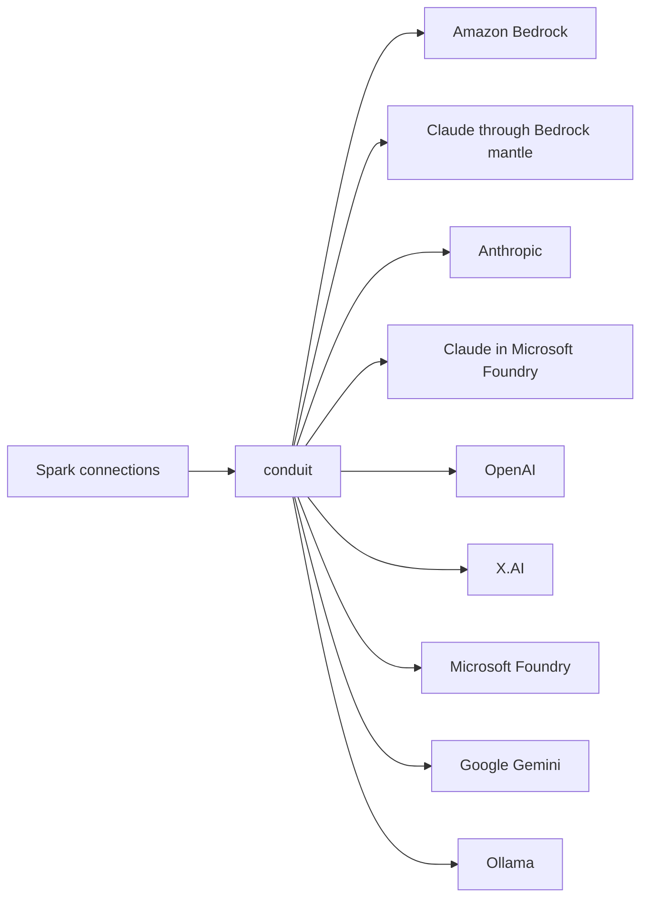

# Model services: accounts and credentials

Spark reaches models through **connections**, one per configured service. This page
covers getting an account and a credential from each service. [Connections](connections.md)
covers adding the connection in Spark: its fields, authentication modes, Region,
residency and models. conduit's
[providers guide](https://github.com/Cognisn/conduit/blob/release/v0.1.0/docs/guides/providers.md)
is the reference for how each service is called.

Spark offers nine services:



The account steps on this page are each service's own and were not run for this guide:
they need real accounts and keys, which a test sandbox never holds.

Whatever the service, a key you type into Spark goes straight to the secrets store and
is never shown again. Keep your own copy somewhere safe, or create a new key if you
lose it.

## Anthropic

1. Visit the [Anthropic Console](https://console.anthropic.com/) and sign up, with an
   email address or Google or GitHub sign-in.
2. Add a payment method under **Settings > Billing**. API access needs an active
   billing profile.
3. Under **Settings > API Keys**, choose **Create Key**, name it (for example "Spark")
   and copy it at once: the Console does not show it again.
4. In Spark, add an **Anthropic** connection and paste the key into **API key**.

Troubleshooting:

- **Discovery says the service refused the request.** Check the key is correct, has not
  been revoked and has no spaces around it.
- **Billing errors.** Check the Console's billing page.
- **Rate limits.** Wait and retry, or raise your usage tier in the Console.

## Amazon Bedrock and Claude through Bedrock (mantle)

1. Sign in to the [AWS Management Console](https://console.aws.amazon.com/).
2. Open **Amazon Bedrock** in the Region you want to use (for example
   `ap-southeast-2`). Not every model is offered in every Region.
3. Under **Model access**, request access to the models you want. Most Anthropic models
   are approved at once.
4. Choose how Spark authenticates (the modes are described in
   [Connections](connections.md#amazon-bedrock)):
   - **The AWS credential chain**: whatever the AWS CLI on this machine uses (for
     example `aws configure sso` and `aws sso login`, or an instance or container
     role), with an optional named profile.
   - **AWS access keys**: an IAM user's access key pair, with a session token for
     temporary credentials.
   - **Short-term Bedrock API keys**: generated by Spark from either of the above and
     refreshed before they expire. With long-term keys, the only modes on the mantle
     endpoint.
   - **A long-term Bedrock API key**: created in the Bedrock console. AWS recommends
     these for exploration only, so Spark offers them only once the connection's
     **Allow long-term Bedrock API keys** is ticked.
5. Give the credentials `bedrock:InvokeModel` and
   `bedrock:InvokeModelWithResponseStream`, and for model discovery
   `bedrock:ListFoundationModels` and `bedrock:ListInferenceProfiles`.
6. In Spark, add an **Amazon Bedrock** (or **Claude through Amazon Bedrock (mantle)**)
   connection with the Region and authentication.

You can check credentials outside Spark with `aws sts get-caller-identity` and
`aws bedrock list-foundation-models --region <region>`.

> Not run for this guide: the AWS CLI commands and the console steps, which need a
> real AWS account.

Troubleshooting:

- **A model shows as Refused.** Geographic (`au.`, `eu.`, `us.` and so on) and
  `global.` inference profiles process requests outside the connection's Region. A new
  Bedrock connection allows in-Region processing only; change its residency to allow
  them (see [Region and residency](connections.md#region-and-residency)).
- **A model is Not reachable.** Request model access in the Bedrock console, in the
  connection's Region.
- **Credentials refused.** For SSO, run `aws sso login` again. For access keys, check
  the IAM permissions above.

## Claude in Microsoft Foundry and Microsoft Foundry (OpenAI-compatible)

1. In the [Microsoft Foundry portal](https://ai.azure.com/), create or open a resource
   and deploy the models you want. Note each **deployment name**: it is the model id
   Spark uses.
2. Copy the resource's endpoint: `https://<resource>.services.ai.azure.com/anthropic/`
   for Claude, `https://<resource>.openai.azure.com/openai/v1/` for the
   OpenAI-compatible endpoint.
3. Either copy an API key from the resource, or use Microsoft Entra ID: Spark then uses
   azure-identity's default credential on the machine it runs on (a managed identity,
   workload identity, environment variables or a developer sign-in).
4. In Spark, add the connection with the endpoint, the authentication and the
   resource's Region.

Foundry deployments must be declared to Spark's catalogue, and the screens cannot yet
do this for Foundry: see the note under
[Declaring a model the catalogue lacks](connections.md#declaring-a-model-the-catalogue-lacks).

## OpenAI

1. Sign in to the [OpenAI Platform](https://platform.openai.com/) and add billing.
2. Under **API keys**, create a key and copy it.
3. In Spark, add an **OpenAI** connection and paste the key. Organisation and project
   are optional.

Signing in with a ChatGPT subscription is not supported: Spark uses the OpenAI API.

## Google Gemini

1. Visit [Google AI Studio](https://aistudio.google.com/) and sign in with a Google
   account.
2. Choose **Get API key**, then **Create API key** (the default Google Cloud project is
   fine for personal use), and copy it.
3. In Spark, add a **Google Gemini** connection and paste the key.

The Gemini API has a free tier; see the
[pricing page](https://ai.google.dev/gemini-api/docs/pricing) for its limits. Vertex AI
is not served.

## X.AI

1. Visit the [X.AI Console](https://console.x.ai/) and sign up.
2. Add billing, then create an API key under **API Keys** and copy it.
3. In Spark, add an **X.AI** connection and paste the key.

## Ollama

Ollama runs models locally: no account or key is needed, and nothing leaves the
machine.

1. Download Ollama from [ollama.com](https://ollama.com) (on macOS,
   `brew install ollama` also works) and start it.
2. Pull a model, for example `ollama pull llama3.1:8b`, and check with `ollama list`.
3. In Spark, add an **Ollama** connection. The default Base URL
   `http://127.0.0.1:11434` suits a local install.
4. Open the connection's **Models**, press **Check reachable models**, and declare each
   pulled model the catalogue lacks (see
   [Declaring a model the catalogue lacks](connections.md#declaring-a-model-the-catalogue-lacks)).

You need enough memory for the model (8 GB at least, 16 GB or more recommended). If a
model's full context window is more than the host can hold, set the connection's
**Context length**.

Troubleshooting:

- **Discovery fails.** Check Ollama is running (`ollama serve`) and the Base URL is
  right.
- **A pulled model is missing.** Declare it from the models view.

## Choosing models

Each connection offers the models enabled on it. The model picker groups them by
connection, with each model's tier and, on a metered server connection, the credits
left this month. A conversation's model can be changed at any time from the chat
header.

`default_model` pre-selects a model for new conversations, as a `connection/model`
reference:

```yaml
default_model:
  model_id: home-ollama/llama3.1:8b
  mode: default                  # default = pre-selected, mandatory = locked
```

A bare model id kept from 0.2 still resolves to a connection that offers it.

## Context windows and prompt caching

Each model's context window, output limit and capabilities (tools, vision, prompt
caching, structured output) come from conduit's catalogue, or from the declaration you
saved for it. The models view shows them. The 0.2 `context_limits` section of
`config.yaml` is no longer read.

With prompt caching on (`conversation.prompt_caching`, default on, which a conversation
can override in its settings), Spark puts a cache breakpoint after the system prompt,
which includes any skills loaded in the conversation, and asks for the tool
definitions to be cached too. conduit applies them where the catalogue says the model
supports prompt caching, and cached tokens are recorded apart as cache reads and
writes (see [Metering](metering.md)).
