# Diagram types

One working example of each type. The examples are synthetic: names and figures are invented.

## flowchart

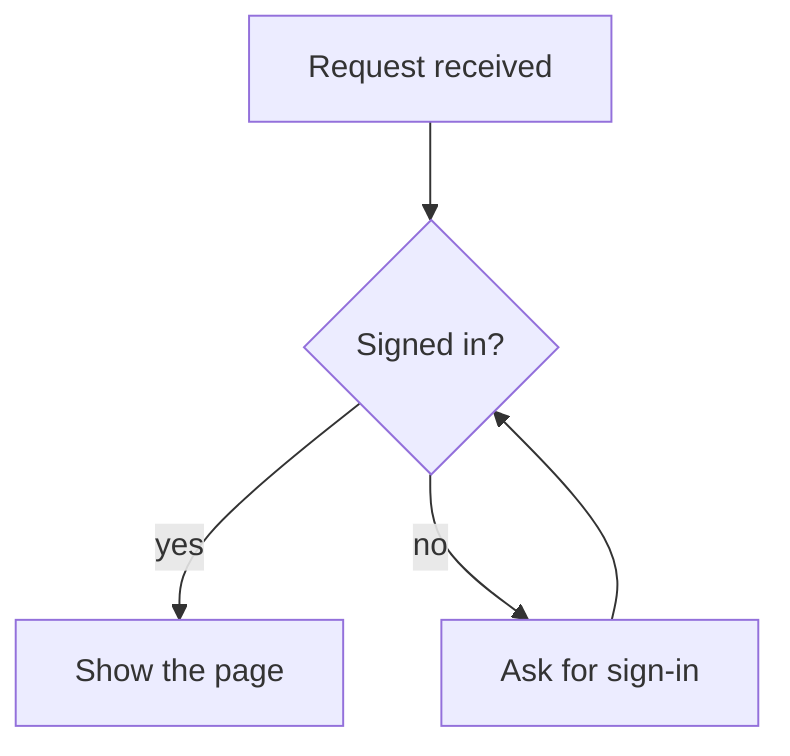

Directions: `TD` (top down), `LR` (left to right), `BT`, `RL`. Shapes: `[box]`, `(rounded)`, `{decision}`, `((circle))`, `[(database)]`. Group nodes with `subgraph Name` and `end`.

## sequenceDiagram

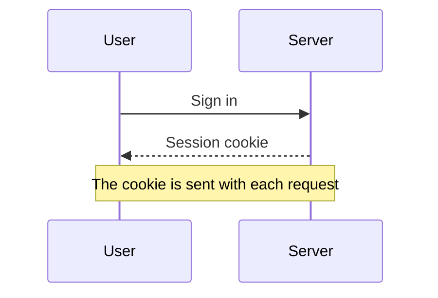

`->>` is a solid arrow, `-->>` a dashed reply. Use `alt` and `else` for choices and `loop` for repeats, each closed by `end`.

## classDiagram

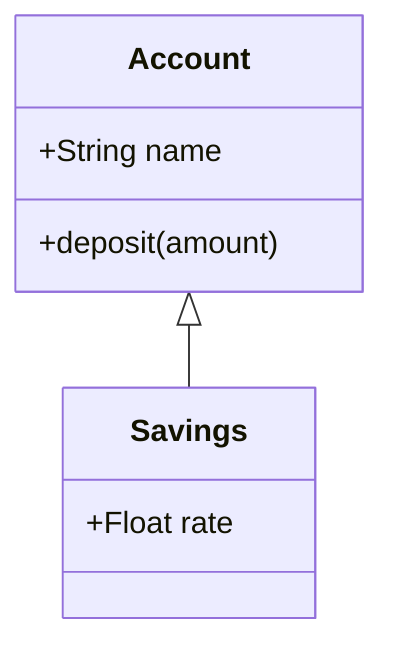

## stateDiagram-v2

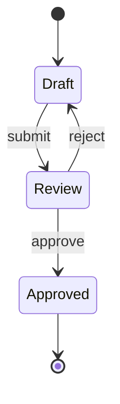

## erDiagram

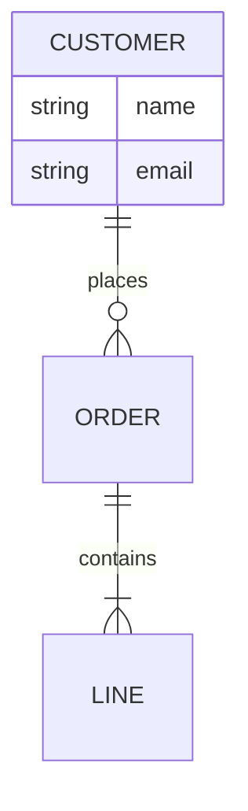

## gantt

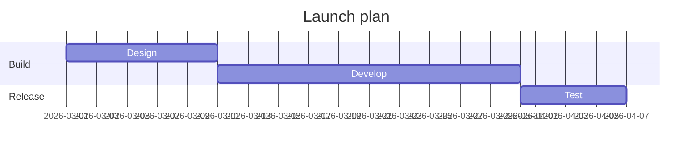

## timeline

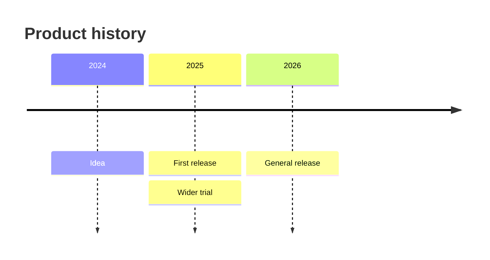

## mindmap

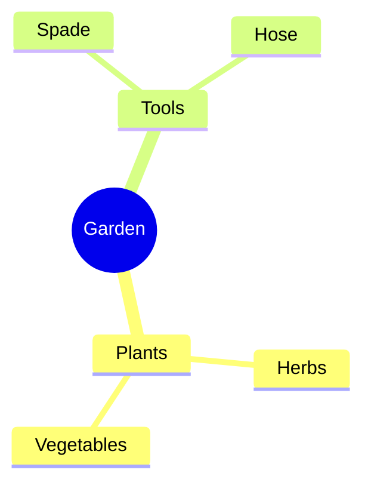

## journey

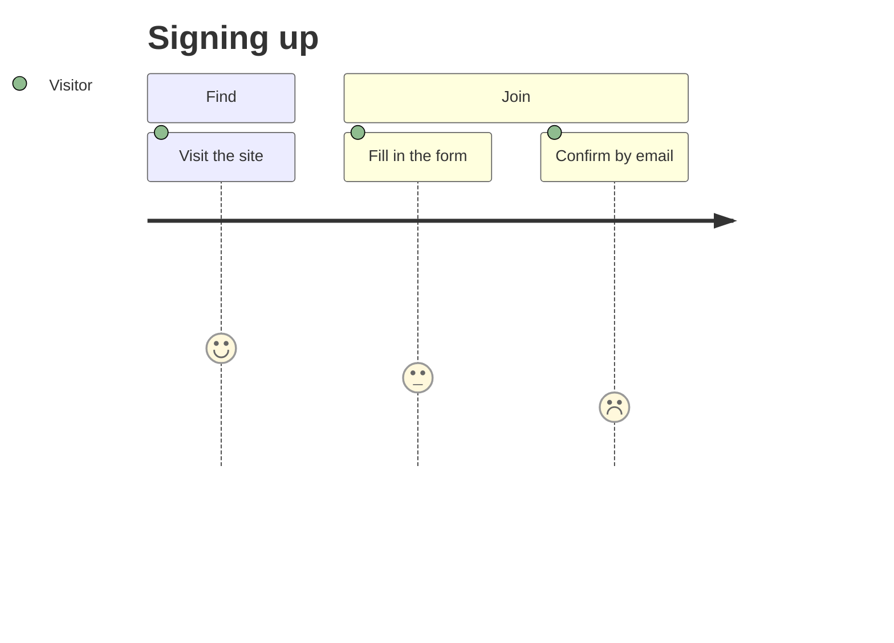

## pie

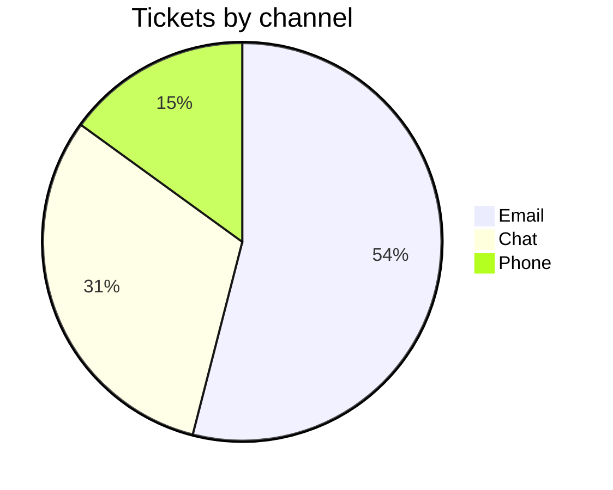

## gitGraph

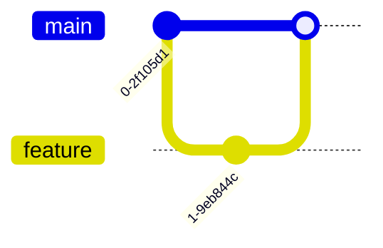

## quadrantChart

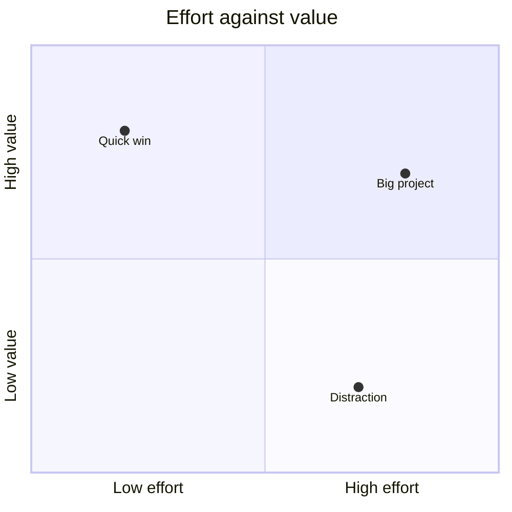

## The one thing SPARK refuses

A settings directive is refused, so never write this:

```mermaid
%%{init: {"theme": "dark"}}%%  (refused: remove it)
flowchart TD
  A --> B
```
